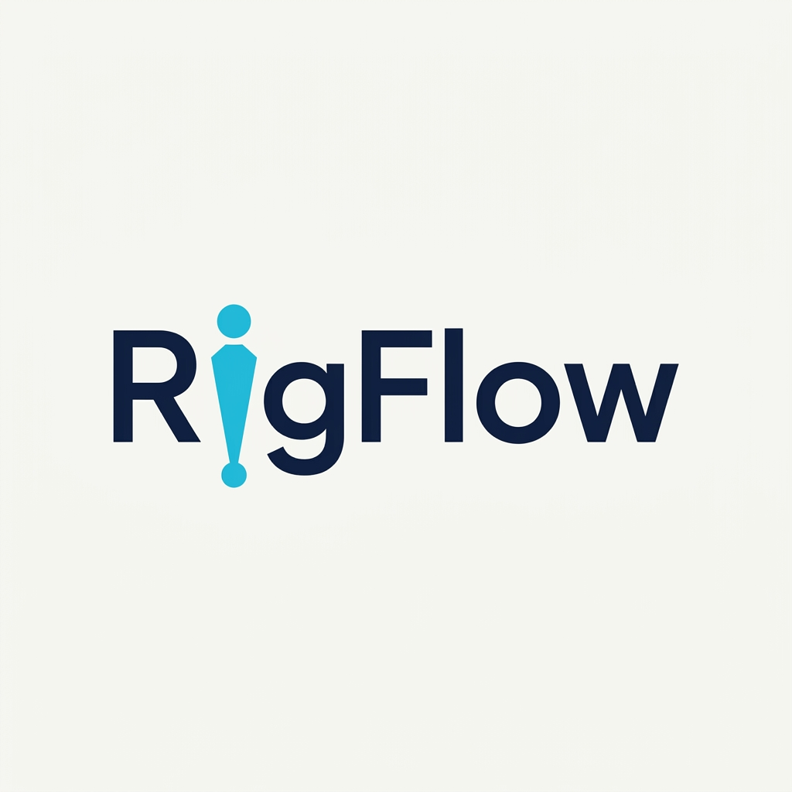
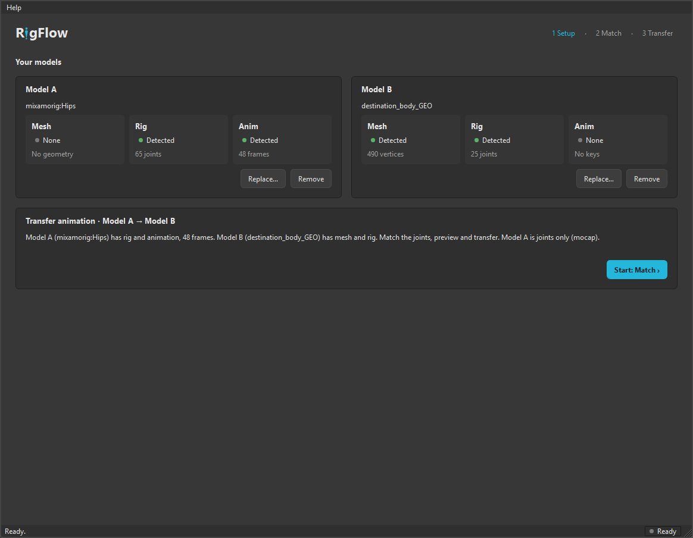
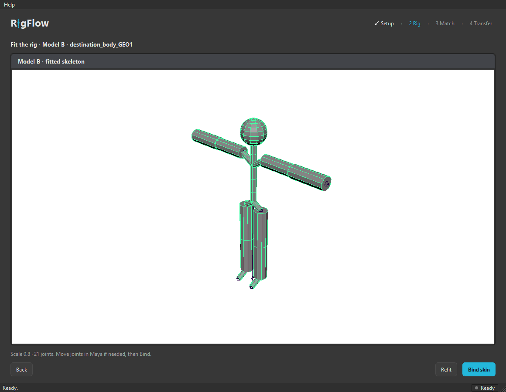
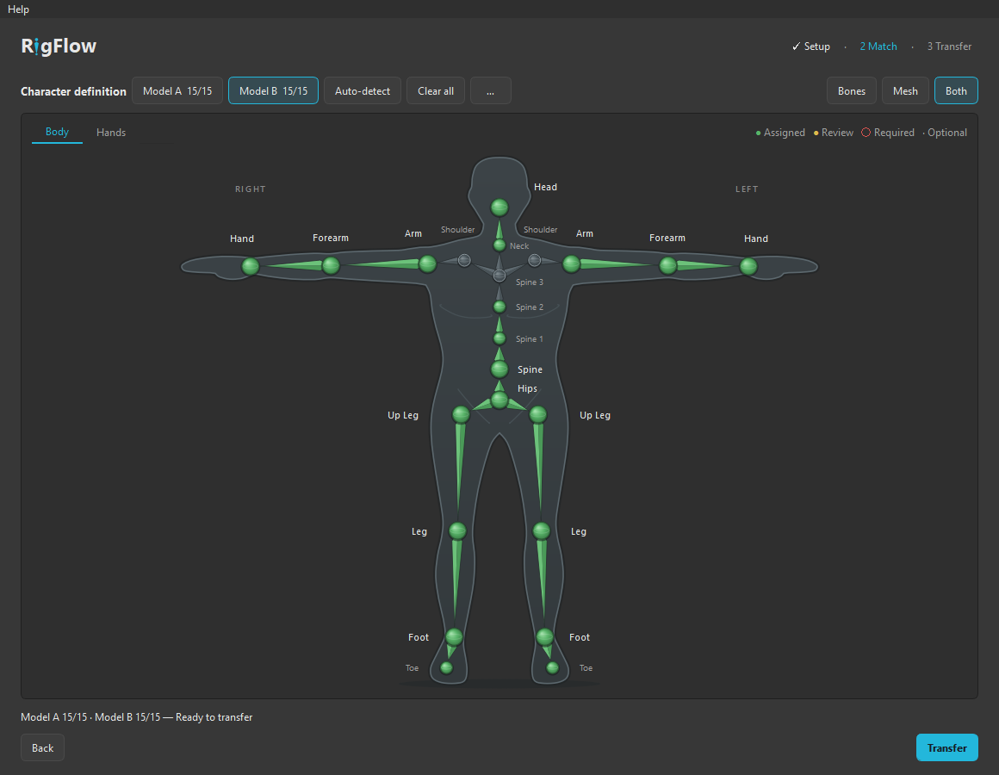
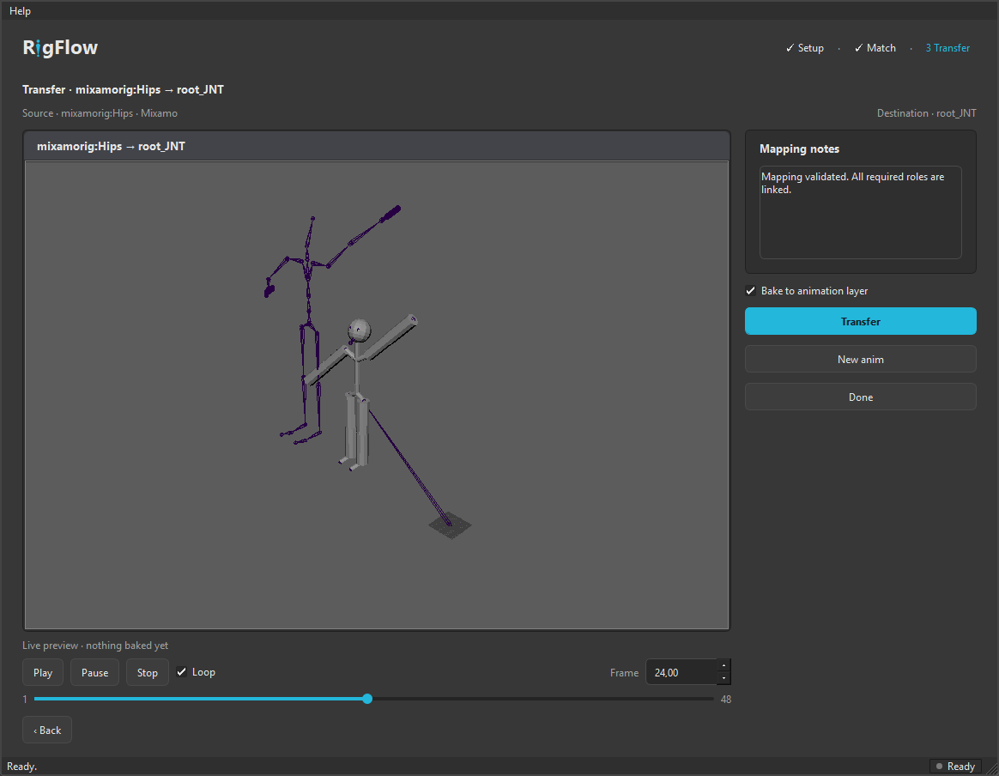

<p align="center">
  
</p>

<h1 align="center">Animation Transfer for Maya</h1>

<p align="center">
  Transfer animation between characters with different proportions, skeletons and naming conventions.<br>
  <strong>Add models → Fit rig if needed → Match → Preview → Transfer → keep animating.</strong>
</p>

> **Status: alpha, under active development.** Model detection, skeleton
> analysis, joint matching, FBX/OBJ/Maya import, rig fitting and binding, the
> HumanIK and matrix retargeting backends and the PySide interface are
> implemented and covered by 96 unit tests and 61 Maya integration tests
> (Maya 2023 and 2024), plus an end-to-end check inside Maya's UI. No public
> release has been cut yet. See `CHANGELOG.md`.

## Screenshots

| Setup | Rig | Match | Transfer |
|-------|-----|-------|----------|
|  |  |  |  |

Real captures from Maya 2024 with the demo scene. Setup shows Model A (Mixamo-
style joints with a jump) and Model B (skinned mannequin) with the process
RigFlow proposes; Rig shows the source skeleton fitted onto a mesh-only copy
before binding; Match shows the two models side by side; Transfer shows the
live HumanIK preview at frame 24 before baking.

## What RigFlow does

- Works with whole models: add a scene, FBX, OBJ or Maya selection and RigFlow
  detects the mesh, the rig and the animation it brings, then proposes the
  process for the two models you added.
- Copies a skeleton onto a mesh-only model (fit to its height, bind) when the
  destination has no rig yet.
- Labels both skeletons against a canonical humanoid template using joint
  names **and** hierarchy topology, with a confidence score for every joint.
- Shows the proposed source-to-destination joint matches with green / yellow /
  red statuses and lets you correct them by hand. Manual fixes survive recomputation.
- Retargets body animation onto the destination skeleton with a live preview
  before anything is baked (HumanIK where available, matrix-based fallback otherwise).
- Keeps the destination rig intact: facial, eye and jaw controls are never
  touched, so you can keep animating the face after the body transfer.

## What RigFlow does not do (yet)

- It does not retarget facial animation.
- The rig it copies onto a mesh-only model is a starting point (uniform fit,
  closest-distance skin weights), not a production rig.
- It does not guarantee results on arbitrary non-humanoid or heavily
  customised rigs. Common humanoid skeletons come first.
- It does not bake onto animation controls of FK/IK rigs in v1; it bakes onto
  the destination skeleton joints (or an animation layer on them).

## Supported environment

| Maya | Python | Qt | Status |
|------|--------|----|--------|
| 2024 | 3.10 | PySide2 | Primary development target |
| 2023 | 3.9 | PySide2 | Tested headless (`mayapy`) |
| 2025 / 2026 | 3.11 | PySide6 | Planned through the Qt shim, not yet verified |

## Installation

1. Download or clone this repository to a permanent folder.
2. Start Maya and drag `scripts/install.py` into the viewport.
3. Click the new **RigFlow** shelf button.

The installer writes one Maya module file and one shelf button; nothing
else is modified. Uninstall with `scripts/uninstall.py`. Full details in
[`docs/user/installation.md`](docs/user/installation.md).

## Try it without assets

```python
import rigflow.scene.demo as demo
demo.build_demo_scene(new_scene=True)   # Mixamo-style source + short destination
import rigflow; rigflow.launch()
```

Or simply **Help → Create demo scene** inside RigFlow: it adds both models
and detects their contents. Press **Start: Match ›**, **Next: Transfer ›**,
then **Transfer**. After building the scene from Python, add `mixamorig:Hips`
and the destination mesh using **+ → From scene…** or **Use Maya selection**.

**Setup** works with whole models: add a `.ma`, `.mb`, `.fbx`, `.obj` or Maya
selection, and each model card shows its detected Mesh / Rig / Anim slots.
Add the second model and start the proposed process. A mesh-only destination
adds **Rig** (fit and bind the source skeleton) before **Match** (source and
destination viewports with Match / Unmatch) and **Transfer** (live preview
and bake). **Swap direction** chooses the source when both are animated;
**New anim** replaces the source while keeping the destination.

## Documentation

- [Installation](docs/user/installation.md) · [Compatibility](docs/user/compatibility.md)
- [Skeleton matching](docs/user/skeleton-matching.md) · [Animation transfer](docs/user/animation-transfer.md)
- [Troubleshooting](docs/user/troubleshooting.md)
- [Developer documentation](docs/developer/README.md) · [Architecture](docs/developer/architecture.md)

## Development

```bash
MAYAPY="C:/Program Files/Autodesk/Maya2024/bin/mayapy.exe"
"$MAYAPY" -I scripts/run_tests.py                # unit tests (seconds)
"$MAYAPY" -I scripts/run_tests.py --integration  # + Maya integration tests
"$MAYAPY" scripts/ui_preview.py                  # open the UI with fake data, outside Maya
```

See [`CONTRIBUTING.md`](CONTRIBUTING.md) and
[`docs/development/01-feasibility-and-architecture.md`](docs/development/01-feasibility-and-architecture.md).

## License

MIT. See [`LICENSE`](LICENSE). RigFlow calls Autodesk Maya and HumanIK through
their public APIs and does not redistribute any Autodesk or third-party assets.
